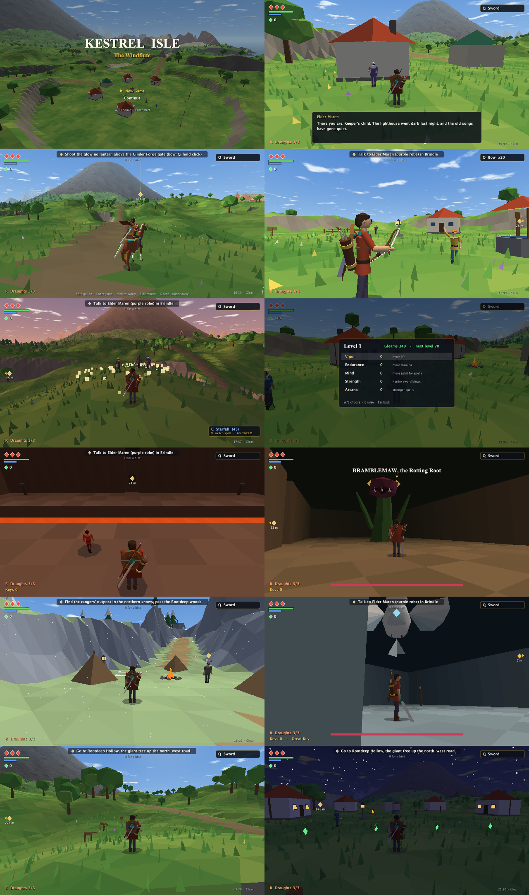

# Kestrel Isle: The Windflute

An original 3D action-adventure in pure Java (no libraries). It uses its own software renderer, a synthesized soundtrack and hand-built dungeons.

The Hollow has stolen the Wardstones of Kestrel Isle. Starting in the village of Brindle, you recover them from Rootdeep Hollow, the Cinder Forge and the Tidewell Vault. Then you head north through the snow to Rimeholt, an ice-hold on a sheer mesa, for the fourth stone. Last, you descend into the Hollow Crown to face the Hollow King, and to learn who he used to be.

Along the way:

- **Side quests:** Tibb, Ansel, Oskar and Hessa each need a hand. The satchel (Tab) lists them under Requests, and blue diamonds mark where to go.
- **The grapple claw** works out in the world too:
  - grapple the gold-lit posts on cliffs, spires and sea stacks;
  - lock on and yank enemies to you;
  - tear shields away;
  - fetch things that are out of reach.
- **A living island:** deer, foxes, rabbits and birds bolt when you come near, fish jump, and there are butterflies by day and fireflies by night. Villagers stroll around and head home after dark, windows light up, and chimneys smoke.

## Download and play

Get the latest build from the [Releases page](https://github.com/MartelDanger3232/kestrel-isle/releases/latest). The Mac, Windows and Linux downloads include their own Java, so there's nothing else to install.

- **Mac (Apple Silicon):**
  1. Download `KestrelIsle-Mac-AppleSilicon.zip`, unzip it and drag **Kestrel Isle** into Applications.
  2. The game isn't signed by Apple, so the first launch is blocked. Open **System Settings → Privacy & Security**, scroll down and click **Open Anyway**.
  3. If macOS ever says the app is damaged, run `xattr -dr com.apple.quarantine "/Applications/Kestrel Isle.app"` in Terminal.
- **Windows:** download `KestrelIsle-Windows.zip`, unzip it, and run `KestrelIsle.exe` inside the `KestrelIsle` folder. If SmartScreen warns you, click **More info**, then **Run anyway**.
- **Linux:** download `KestrelIsle-Linux.tar.gz`, extract it, and run `KestrelIsle/bin/KestrelIsle`.
- **Anything else with Java 22 or newer, including Intel Macs:** download `kestrel-isle.jar` and run `java -jar kestrel-isle.jar`.

## Run from source

You need JDK 22 or newer.

    ./run.sh

`./package.sh` builds a self-contained app for your own computer into `build/app`. Publishing a GitHub release builds the Windows, Mac and Linux downloads automatically (`.github/workflows/release.yml`).

It always runs full screen. Esc pauses, then Q quits.

Progress autosaves to `save.properties` in a `.kestrel-isle` folder in your home folder (`~/.kestrel-isle` on Mac and Linux, `C:\Users\<you>\.kestrel-isle` on Windows). Choose **Continue** on the title screen to resume.

## Controls

| | |
|---|---|
| WASD | move |
| Mouse or arrow keys | camera |
| Space | roll; while locked on, side-hop (A/D) or back-flip (S) |
| Shift (hold) | lock on to the nearest foe |
| Click / J | sword (3-hit combo; hold, then release for a spin attack) |
| K / right-click | shield |
| F | use item (bow and claw: hold to aim, release to fire; bombs: F to light, F to throw) |
| Q | switch item |
| C · V | cast spell · switch spell (spells use spirit, the blue bar) |
| R | drink an Ember Draught (refilled at Lantern Shrines) |
| T, then 1-5 | play the windflute (the Song of the Steed calls Juniper the horse) |
| E | talk, read, open, ride/dismount, rest at a shrine |
| G | send Juniper away (the Song of the Steed calls her back) |
| H | hint for wherever you are |
| Tab · M · Esc | satchel · map · pause (Q quits from pause) |

Rolling, swinging and blocking use stamina (the green bar). Rest at Lantern Shrines to heal, refill draughts, level up five stats and fast-travel. Resting brings monsters back. If you fall, your gleams stay where you died until you reach them again. Each boss teaches a spell, Oskar the smith sharpens your sword for gleams, and holding all four Wardstones makes you Ascended.

## Dev flags

**Dev keys:** `` ` `` (above Tab) completes the current objective (inside a dungeon it finishes the whole dungeon and hands over its rewards), `=` teleports you to the current objective, and `]` gives 1000 gleams.

Blast Pods (glowing orange plants) give 3 bombs each and regrow, so you can't get stuck without bombs.

`--test` runs scripted checks of movement, combat, songs, puzzles, bosses and saving. `--bench` times rendering. `--shots DIR` writes headless screenshots.
